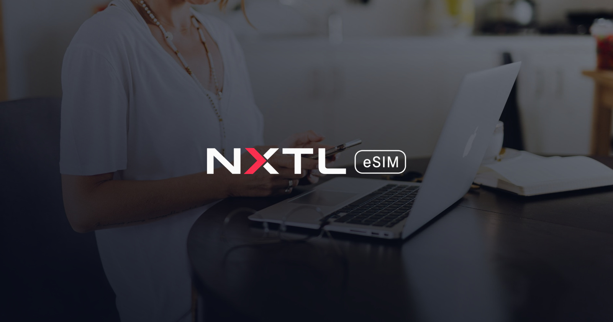

# Laptop & hotspot backup for remote workers

> **Disclosure:** Written by the NXTL eSIM Team. NXTL is our product. NXTL facts checked on nxtlsim.com on 26 Oct 2026.

Hotel Wi‑Fi dies five minutes before a client call. The co-working network blocks your VPN. The café router reboots mid-upload. A backup mobile line you can switch to in under a minute is cheap insurance — and with pay-as-you-go you only pay for what you actually use.

## Why NXTL as your backup line
- **Data-only PAYG, no monthly subscription**, charged proportionally in **1 KB increments** ([pricing](https://nxtlsim.com/pricing/)).
- **Unused prepaid balance never expires** ([FAQ](https://nxtlsim.com/faq/); account terms apply) — the backup is ready for the next outage or trip.
- **Hotspot/tethering supported**, subject to compatible devices and network; laptop traffic over the hotspot uses the **same prepaid balance** as the phone, with no separate hotspot bundle ([laptop hotspot guide](https://nxtlsim.com/travel-esim-hotspot-laptop-abroad/)).
- **180+ countries, 460+ networks, 5G where available** ([coverage](https://nxtlsim.com/esim-coverage/)).
- Keep your normal SIM for calls and your number, subject to your phone's dual-SIM support ([FAQ](https://nxtlsim.com/faq/)).

## ⚠️ Activation rule: pick the right device
**NXTL eSIM binds to the first device it is activated on.** Decide up front which device will use the internet:
- **Option A — Phone hotspot (most common):** activate the eSIM **on your phone**. The laptop just joins the phone's Wi‑Fi hotspot — **no eSIM needed in the laptop** ([source](https://nxtlsim.com/travel-esim-hotspot-laptop-abroad/)).
- **Option B — Laptop with built-in cellular eSIM:** activate the eSIM **directly on the laptop**. This needs an eSIM-capable cellular laptop and its own profile.
- **Option C — Pocket/travel router:** activate the eSIM **directly on the router** (see [router failover guide](router-failover.md)).
- **Using a 9eSIM card?** The **IMEI of the device that will use the data must also be set up**.

Don't activate on one device "to try it" — it stays bound to the first device. Activated on the wrong device by mistake? The eSIM can be exchanged automatically in NXTL's system. Need both? Get a second eSIM on the same account balance. Check [compatible devices](https://nxtlsim.com/esim-compatible-devices/) first.

## Set it up before you need it (10 minutes, once)
1. Install the NXTL eSIM on the chosen device and **test mobile data** on it once, with roaming enabled.
2. Keep the eSIM line **installed but not selected for data** (on phones: keep your main line for data, or turn mobile data off) until you need it.
3. **Option A:** set a hotspot name and strong password now; on the laptop, save the network and **mark it as metered** (see below).
4. Note your balance and set a top-up reminder in the NXTL account/app.

## The 60-second switch when Wi‑Fi fails
1. Phone: switch mobile data to the NXTL line (Settings → Mobile/Cellular → Mobile Data).
2. Turn on Personal Hotspot.
3. Laptop: join the saved hotspot (or USB-tether for a more stable link and battery charging).
4. Pause sync clients and updates (checklist below), then join your call.
5. When the Wi‑Fi is back, switch the laptop to it and turn the hotspot off.

## Keep data use low (and the bill small)
Every connected device's traffic costs money, and laptops behave as if a hotspot were unlimited office Wi‑Fi ([source](https://nxtlsim.com/travel-esim-hotspot-laptop-abroad/)). Fix that:
- **Mark the hotspot as metered:** Windows — Settings → Network & internet → Wi‑Fi → *[hotspot]* → Metered connection: On. macOS — on recent versions, Wi‑Fi → Details → **Low Data Mode**. (Menu names vary by OS version.)
- **Pause cloud sync:** OneDrive, Google Drive, Dropbox, iCloud, photo libraries.
- **Defer OS and app updates**, game launchers and store downloads.
- **Video calls:** turn camera off when not needed or lower video quality; audio-only uses far less.
- **Browser:** close streaming tabs and auto-playing video.
- **Measure, don't guess:** check per-app usage in your OS and the balance in your NXTL account after a typical hour of work; budget from your own numbers. Use the [trip cost planner](https://nxtlsim.com/pricing/) for per-country rates.
- **Choose network preference** "Cheapest" or "Best coverage" in the NXTL app/account depending on whether cost or signal matters more right now.

## Before an important call
- Test the hotspot 10 minutes before, not when the Wi‑Fi dies.
- Keep the phone charged (or plugged into the laptop via USB tethering) and near a window for better signal.
- Have the call's dial-in number ready as a last resort over your normal SIM.

## For teams
Equip your remote staff with backup lines funded from **one company balance** where unused balance never expires — see [NXTL for Business](https://nxtlsim.com/for-business/).

---
NXTL eSIM Team · [nxtlsim.com](https://nxtlsim.com/) · support@nxtlsim.com
