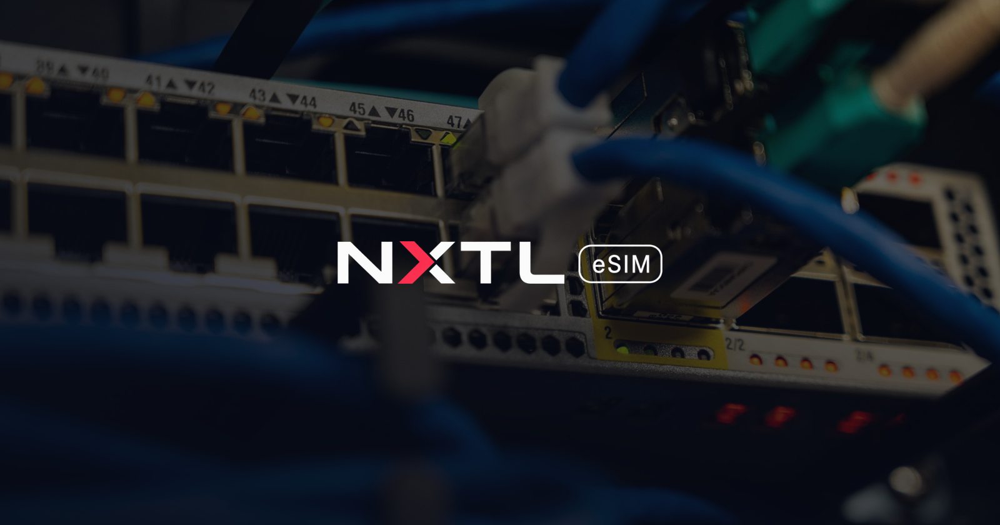

# Backup internet on a 4G/5G router with an NXTL eSIM



> **Disclosure:** Written by the NXTL eSIM Team. NXTL is our product. NXTL facts checked on nxtlsim.com on 26 Oct 2026.

Your fibre goes down at 11:00 on a Monday. Card terminals stop, calls drop, cloud tools freeze. A cellular backup line on your router fixes that — and with a **pay-as-you-go** eSIM you're not paying a monthly fee for a line that sits idle 99% of the time.

## Why NXTL for router backup
- **No monthly subscription; data-only PAYG** — usage is charged proportionally in **1 KB increments** ([pricing](https://nxtlsim.com/pricing/)). An idle backup line costs no monthly fee.
- **Unused prepaid balance never expires** ([FAQ](https://nxtlsim.com/faq/); account terms apply) — top up once, keep it ready.
- **Router-ready:** NXTL "provides standard cellular data connectivity compatible with eSIM-enabled tablets, laptops, mobile routers, and telemetry hardware across supported partner networks" ([for business](https://nxtlsim.com/for-business/)).
- **180+ countries, 460+ networks, 5G where available** ([coverage](https://nxtlsim.com/esim-coverage/)) — useful for multi-site or mobile setups (vans, pop-ups, events).
- **One balance for many sites:** multiple eSIMs on one account draw from one balance; businesses can manage lines in a portal or via the [REST API](https://nxtlsim.com/nxtl-api-reference/).

## ⚠️ Activation rule (most important step)
**NXTL eSIM binds to the first device it is activated on.**
1. Install and activate the eSIM **directly on the router that will provide the backup internet**. Do not activate it on a phone or another device first — it will then be bound to that device.
2. If your router uses a **9eSIM card** (a removable eSIM-capable SIM loaded via an app), the **router's IMEI must also be set up** as part of activation.
3. One eSIM per router. For more sites, add more eSIMs to the same account balance.

Not sure the router supports eSIM profiles? Check the [compatible devices](https://nxtlsim.com/esim-compatible-devices/) page and your router's spec sheet *before* buying.

## What you need
- A 4G/5G router that supports **eSIM** (built-in eSIM / eUICC) or accepts a 9eSIM-type card, with a dual-WAN or failover feature. Many widely used business and travel router brands offer models with this; check the specific model.
- A primary connection (fibre, cable, DSL) on the router's WAN port.
- An NXTL account with balance ([get started](https://nxtlsim.com/pricing/)).

## General setup steps
1. **Update the router firmware.** eSIM and failover features often arrive in updates.
2. **Install the NXTL eSIM on the router** using the router's eSIM manager (QR code / activation code / LPA string), or load it onto the 9eSIM card for that router (and register the router's IMEI). Follow the [installation guide](https://nxtlsim.com/faq/) and set APN: `plus`.
3. **Enable data roaming** on the cellular interface if the router asks — NXTL connects via partner networks.
4. **Test the cellular link on its own:** unplug the primary WAN, confirm the router gets an IP on the mobile interface and loads a page. Reconnect.
5. **Configure failover** (often called *WAN failover*, *dual-WAN backup* or *multi-WAN*):
   - Primary = wired WAN, backup = cellular.
   - Health check = ping 2+ reliable hosts (e.g. `1.1.1.1`, `8.8.8.8`) every 5–10 s; fail after ~3 misses, recover after ~3 successes.
   - Mode = **failover**, *not* load balancing — load balancing sends everyday traffic over the paid line.
6. **Protect your balance:** in the router, block or limit heavy traffic on the backup WAN (OS updates, cloud backups, video). Many routers support a monthly data cap / alert on the cellular interface.
7. **Test the full switch:** pull the WAN cable, time the switch-over, run a call/card payment, plug back in and confirm traffic returns to the primary.
8. **Monitor:** set balance alerts in your NXTL account/app, and choose network preference ("Cheapest" or "Best coverage") there.

## Example: OpenWrt with mwan3
> **Example only.** Generic OpenWrt configuration, not tested by NXTL on a specific model. Interface names (`wan`, `wwan`) and modem protocol depend on your hardware. APN: `plus`.

```sh
opkg update && opkg install mwan3 luci-app-mwan3
```

`/etc/config/network` (cellular interface — protocol varies: `qmi`, `mbim`, `ncm` or `modemmanager`):
```
config interface 'wwan'
	option proto 'qmi'
	option device '/dev/cdc-wdm0'
	option apn 'plus'
	option metric '20'

config interface 'wan'
	option proto 'dhcp'
	option device 'eth1'
	option metric '10'
```

`/etc/config/mwan3`:
```
config interface 'wan'
	option enabled '1'
	list track_ip '1.1.1.1'
	list track_ip '8.8.8.8'
	option reliability '1'
	option interval '5'
	option down '3'
	option up '3'

config interface 'wwan'
	option enabled '1'
	list track_ip '1.1.1.1'
	list track_ip '8.8.8.8'
	option reliability '1'
	option interval '10'
	option down '3'
	option up '3'

config member 'wan_m1'
	option interface 'wan'
	option metric '1'
	option weight '1'

config member 'wwan_m2'
	option interface 'wwan'
	option metric '2'
	option weight '1'

config policy 'failover'
	list use_member 'wan_m1'
	list use_member 'wwan_m2'
	option last_resort 'unreachable'

config rule 'default_rule'
	option dest_ip '0.0.0.0/0'
	option use_policy 'failover'
```
Lower `metric` = preferred, so traffic uses `wan` and moves to `wwan` only when `wan` fails its checks.

```sh
service network restart && mwan3 restart
mwan3 status     # both interfaces should show; wan "online", wwan "online" standby
```
Test: `ifdown wan`, run `mwan3 status` and load a page; then `ifup wan`.

## Troubleshooting
- **No connection on the cellular interface:** confirm the eSIM was activated on *this* router (binding rule), roaming is on, the APN is `plus`, and you have balance.
- **Activated on the wrong device by mistake:** the eSIM can be exchanged automatically in NXTL's system.
- **Backup line using data when primary is up:** you're in load-balancing mode or a rule routes traffic to `wwan`. Switch to failover.
- **Coverage:** check the site's country on [coverage](https://nxtlsim.com/esim-coverage/); availability and 2G/3G/LTE/5G access vary by location and device.

## For businesses
Rolling backup out to many shops, kiosks or field sites? [NXTL for Business](https://nxtlsim.com/for-business/) gives one company balance across lines, a portal to start and an [API](https://nxtlsim.com/nxtl-api-reference/) to automate.

---
NXTL eSIM Team · [nxtlsim.com](https://nxtlsim.com/) · support@nxtlsim.com
